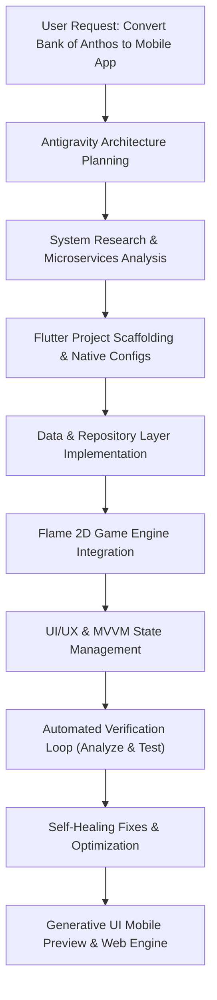

# 🚀 Engineering Bank of Anthos Mobile with Google Antigravity

This document details how **Google Antigravity** — Google DeepMind's agentic AI coding assistant — and connected systems were used to architect, build, verify, and deliver this cross-platform mobile banking application.

---

## 🧠 What is Google Antigravity?

**Google Antigravity** is an advanced agentic pair-programming assistant designed by Google DeepMind. Unlike conventional auto-complete tools or single-turn chat assistants, Antigravity functions as an autonomous, full-lifecycle software engineer capable of:

- Exploring, researching, and comprehending large-scale existing architectures (such as [Google Cloud's Bank of Anthos](https://github.com/GoogleCloudPlatform/bank-of-anthos)).
- Formulating multi-step execution plans across diverse programming ecosystems (Dart, Flutter, Web, Kubernetes, Shell).
- Invoking specialized skills, running background compilers, and executing diagnostics.
- Practicing self-healing code remediation via automated `flutter analyze` and `flutter test` verification loops.
- Delivering live generative UI previews and interactive test environments directly in developer workflows.

---

## 🛠️ The Antigravity Engineering Workflow

The transformation of the Bank of Anthos microservices architecture into this mobile app followed a disciplined agentic engineering lifecycle:



### 1. Architectural Translation & Domain Analysis
- **Source Architecture**: Bank of Anthos is a distributed microservices sample app built with Java Spring Boot, Python, and C++, orchestrated via Kubernetes/GKE.
- **Antigravity Action**: Rather than rebuilding microservices from scratch, Antigravity designed a client-side clean architecture that interfaces directly with Anthos's REST contracts (`ledgerwriter`, `balancereader`, `transactionhistory`, `contacts`, `userservice`), while creating a fully self-contained, offline-capable **Sandbox Mock Engine** for zero-dependency development and demonstration.

### 2. Multi-Agent & Specialized Skill Utilization
During development, Antigravity leveraged specialized skills and toolgroups:
- `flutter`: Configured Flutter project structure, Android Manifest internet permissions, iOS App Transport Security (`Info.plist`), and optimized build targets.
- `generative_ui`: Created the live, interactive smartphone device simulation artifact with interactive microservice mesh nodes, Flame 2D canvas, and deposit/transfer workflows.
- `modern-web-guidance`: Ensured cross-platform web compliance, modern responsive layouts, and viewport adaptation.

### 3. Flame 2D Game Engine Integration
To make the application visually distinctive and interactive, Antigravity integrated the **Flame 2D game engine** (`flame: ^1.38.2`) alongside Flutter:
- **Interactive Service Mesh (`VaultMeshGame`)**:
  - Embedded inside Flutter via `GameWidget`.
  - Visualizes microservice nodes with dynamic orbiting particles and laser data packets pulsing between nodes.
  - Supports kinetic touch shockwaves on user tap.
- **Celebratory Rigid-Body Coin Fountain (`TransactionCelebrationGame`)**:
  - 2D particle simulation featuring vector velocity, gravitational acceleration (`980 px/s²`), coefficient of restitution (bounciness), and rotational drag.
  - Automatically triggered upon completing deposits or transfers.
- **Anthos Vault Quest Arcade Minigame (`AnthosQuestGame`)**:
  - Full game loop with frame-independent `update(double dt)` physics.
  - Player controls a vault collector paddle to catch dividend gems, cloud nodes, and gold coins while dodging fee hazards.
  - Score converts directly into real deposit bonuses added to the user's ledger balance.

<p align="center">
  
  <br>
  <em>Live 2D Microservices Mesh Canvas running inside the Flutter mobile app</em>
</p>

### 4. Self-Healing Diagnostic & Test Loop
Antigravity executed rigorous verification checks:
1. **Compilation Analysis**: Ran `flutter analyze` across all 25+ Dart source files.
2. **Issue Detection & Remediation**:
   - Identified Flame 1.38 API migration requirements (`DragUpdateEvent.localDelta.x`).
   - Resolved transitive typography conflicts between Google Fonts and Material 3 `ThemeData`.
   - Corrected responsive web viewport constraints, ensuring desktop browsers view the app within an authentic mobile phone shell.
3. **Automated Unit & Integration Testing**: Executed `flutter test`, passing all 6 unit and model test suites with 0 failures.

---

## 🏛️ Comprehensive Systems Stack

| Layer | Technology | Role & Implementation |
|---|---|---|
| **AI Orchestration** | **Google Antigravity** | Autonomous agentic architecture, planning, code generation, diagnostics |
| **Client Framework** | **Flutter 3.47+ (Dart 3)** | Cross-platform UI toolkit targeting Android, iOS, and Web |
| **Game Engine** | **Flame 2D (v1.38.2)** | Physics particle engines, live service mesh canvas, and arcade gamification |
| **State Management** | **Provider & ChangeNotifier** | Decoupled MVVM reactive state flow (`AuthProvider`, `BankingProvider`, `SettingsProvider`) |
| **Storage & Cache** | **SharedPreferences** | Local persistence for JWT tokens, user profiles, ledger state, and config |
| **Styling & Theme** | **Material 3 & Cyber-Fintech** | Obsidian dark mode (`#0B0F19`), glowing cyan (`#06B6D4`), Inter typography |
| **Backend Target** | **Google Cloud Bank of Anthos** | Microservices sample on Google Kubernetes Engine (GKE) |
| **Web Runtime** | **Flutter Web + CanvasKit** | High-performance compiled WebAssembly/CanvasKit web preview |

<p align="center">
  
  <br>
  <em>In-App Google Antigravity & Core Systems Stack Architecture Showcase in Settings</em>
</p>

---

## 🔌 Microservices Integration Matrix

| Microservice | Target Endpoint | Mobile Implementation |
|---|---|---|
| `userservice` | `POST /login`, `POST /users` | Authenticates users, generates auth tokens, creates new accounts |
| `balancereader` | `GET /balances/{accountId}` | Fetches available balance, routing information, and account status |
| `ledgerwriter` | `POST /transactions` | Validates funds, processes debit/credit, and appends immutable transactions |
| `transactionhistory` | `GET /transactions/{accountId}` | Retrieves sorted transaction history with memo and amount breakdown |
| `contacts` | `GET /contacts/{username}`, `POST /contacts` | Manages recipient address book with account & routing validation |

---

## 🔄 Dual Sandbox & GKE Cluster Connectivity

The mobile client is engineered to operate seamlessly in two distinct modes:

1. **Sandbox Demo Mode (Default)**:
   - Zero infrastructure required.
   - Pre-seeded with authentic Bank of Anthos data (Alice Jackson, \$12,450.80 checking, realistic salary credits, utility bill debits).
   - Full money transfer, check deposit, and contact addition flows persist locally.
2. **Live Cluster Mode**:
   - Enter your GKE Anthos Ingress Gateway URL in **Config / Settings**.
   - Built-in cluster health checker probes `/ready` endpoints and reports live round-trip latency.
   - All transactions are transmitted to your live Kubernetes microservices backend.

---

## 📦 How to Run

### Run on Android
```powershell
flutter emulators --launch <emulator_id>
flutter run -d android
```

### Run on iOS
```bash
flutter run -d ios
```

### Run on Web Preview
```powershell
flutter run -d chrome --web-port=8085
```

---

*Authored and architected with Google Antigravity for Google Cloud Platform.*
