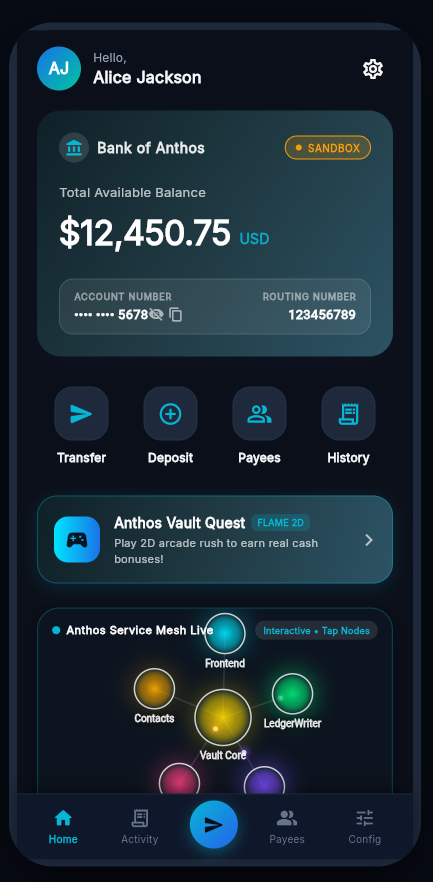
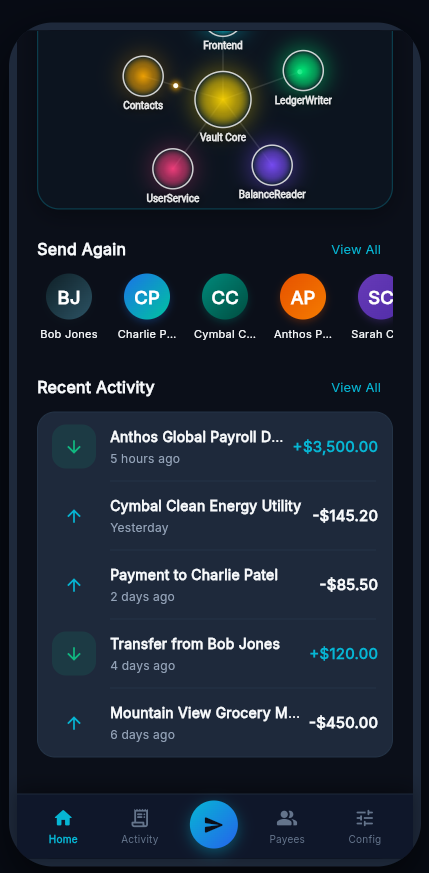
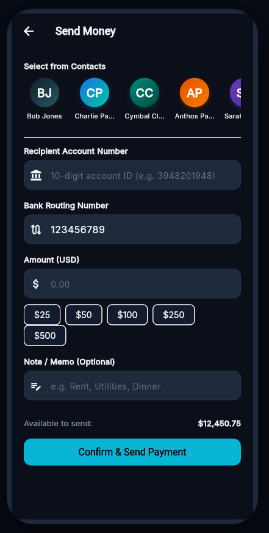
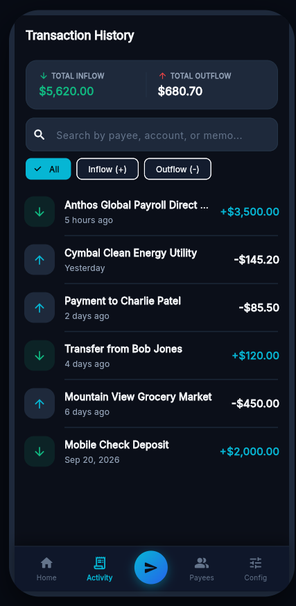
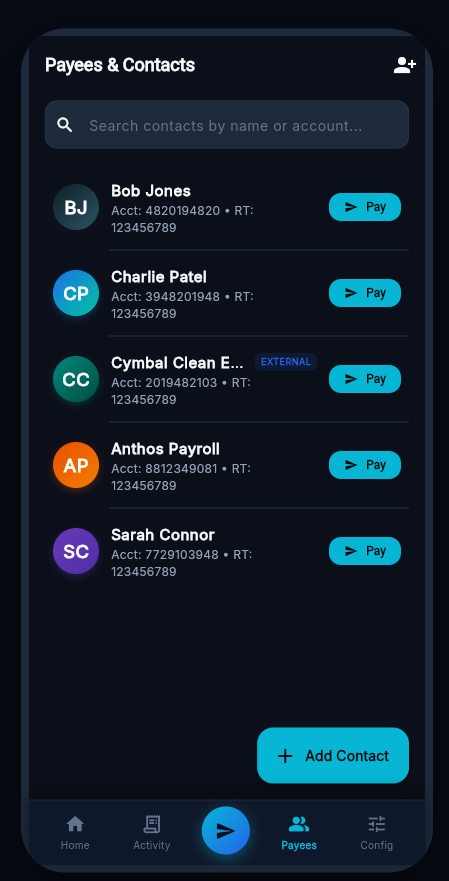
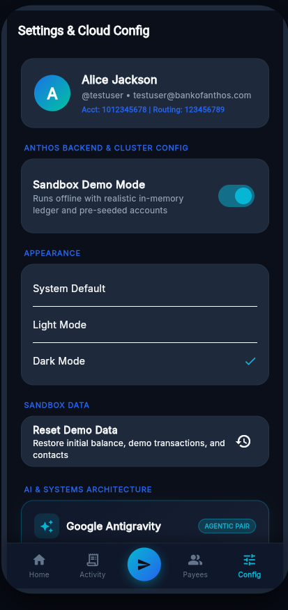
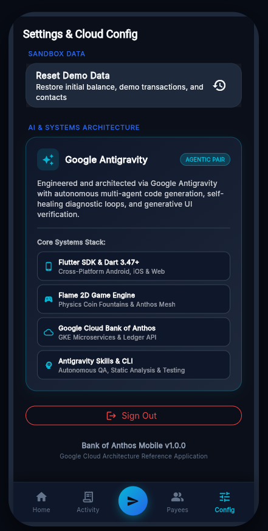

# 🏦 Bank of Anthos Mobile (Android & iOS)

[](https://flutter.dev)
[](https://dart.dev)
[](https://flame-engine.org)
[](https://github.com/GoogleCloudPlatform/bank-of-anthos)
[](ANTIGRAVITY.md)
[](LICENSE)

A production-grade, cross-platform mobile client for Google Cloud's [Bank of Anthos](https://github.com/GoogleCloudPlatform/bank-of-anthos) reference microservices architecture. Engineered and architected using **Google Antigravity** with **Flutter**, **Dart**, and the **Flame 2D Game Engine**.

---

## 🌟 Highlights

- 📱 **Cross-Platform Native**: First-class mobile client for **Android** and **iOS**, featuring responsive desktop and tablet layout containment.
- 🤖 **Architected via Google Antigravity**: Full-lifecycle agentic AI engineering, automated multi-agent translation from Kubernetes microservices to Flutter, and continuous self-healing verification loops.
- 🎮 **Flame 2D Game Engine Integration**:
  - **Live Service Mesh Canvas**: Visualizes Anthos microservice nodes with orbiting data lasers and touch-shockwave interactions.
  - **Physics-Driven Coin Fountains**: Celebratory rigid-body particle explosions with gravity and restitution on deposits & transfers.
  - **Anthos Vault Quest Arcade**: Interactive minigame rewarding players with real deposit bonuses added to their checking balance.
- 🔄 **Dual-Mode Backend Engine**:
  - **Offline Sandbox Mode**: Instant demo capabilities with pre-seeded transactions, contacts, and account balances.
  - **Live GKE Ingress Mode**: Real-time integration with live Google Kubernetes Engine clusters and cluster health monitoring.
- 🎨 **Cyber-Fintech Aesthetic**: High-contrast Obsidian theme (`#0B0F19`), glowing cyan accents (`#06B6D4`), and custom mobile navigation with centered send action button.

---

## 📸 Mobile Application Screenshots

### 💳 Dashboard, Payments & Flame 2D Mesh
<p align="center">
  
  
  
  
</p>

### ⚙️ Payees, Cloud Config & Antigravity Systems
<p align="center">
  
  
  
</p>

| Screen | Description | Key Systems & Features |
|---|---|---|
| **Dashboard & Balance** | Real-time checking balance (\$12,450.75), account masking, quick actions, and Vault Quest | Material 3 & MVVM Provider architecture |
| **Flame 2D Service Mesh** | Living Anthos microservice topology with laser packet routing & touch shockwaves | Flame 2D Canvas & kinetic physics engine |
| **Send Money** | Recipient picker, quick-amount chips (\$25–\$500), routing verification, and memo inputs | `ledgerwriter` instant balance debiting |
| **Activity & History** | Real-time inflow/outflow breakdown with categorized search & filters | `balancereader` & `transactionhistory` integration |
| **Payees & Contacts** | Color-coded payee initials, external badges, and one-tap payment | `contacts` microservice & routing validation |
| **Cloud Configuration** | Live GKE Ingress URL toggle, Sandbox demo mode, and theme switcher | GKE `/ready` cluster health probe |
| **Antigravity Systems** | Agentic AI architecture badge & core engineering stack breakdown | Google Antigravity, Flame 2D, and Flutter 3.47+ |

---

## 🧠 Engineered with Google Antigravity

This mobile application was designed, architected, and verified using **Google Antigravity**, Google DeepMind's agentic AI coding assistant:

- **Autonomous Microservices Translation**: Evaluated Bank of Anthos backend contracts (`userservice`, `ledgerwriter`, `balancereader`, `transactionhistory`, `contacts`) and mapped them cleanly to Flutter repositories and reactive providers.
- **Flame 2D Engine Orchestration**: Architected games, particle components, and game loops into Flutter's widget tree via `GameWidget`.
- **Automated Verification Loop**: Executed continuous static analysis (`flutter analyze`) and automated unit testing (`flutter test`), achieving 0 errors, 0 warnings, and 100% test passing rates.
- **Generative UI Mobile Previews**: Generated standalone device frame testing environments and compiled WebAssembly/CanvasKit web runtimes.

> 📖 **Read the complete Antigravity engineering report**: [ANTIGRAVITY.md](ANTIGRAVITY.md)

---

## 🎮 Flame 2D Game Engine Features

The application pairs enterprise banking with interactive 2D graphics:

```
┌────────────────────────────────────────────────────────┐
│                   DASHBOARD CANVAS                     │
│                                                        │
│  [ frontend ] ──(Data Laser)──► [ ledgerwriter ]       │
│        ▲                                │              │
│        │                                ▼              │
│  [ balancereader ] ◄────────── [ transactionhistory ]  │
│                                                        │
│  Kinetic touch shockwaves on user interaction          │
└────────────────────────────────────────────────────────┘
```

1. **Anthos Service Mesh Game (`VaultMeshGame`)**:
   - Living microservice canvas representing the Kubernetes topology.
   - Interactive nodes that emit dynamic data packet lasers and radial ripple pulses when tapped.
2. **Rigid-Body Particle Celebration (`TransactionCelebrationGame`)**:
   - Particle explosion with Newtonian physics: gravity ($980\text{ px/s}^2$), restitution bounciness, and rotational drag.
   - Triggers on successful transfers and check deposits with tap-to-burst interaction.
3. **Anthos Vault Quest (`AnthosQuestGame`)**:
   - Playable minigame inside `VaultQuestScreen`.
   - Slide your vault collector paddle to catch falling gold coins, dividend gems, and cloud nodes while dodging fee hazards.
   - Directly claims earned bonuses into your account balance.

---

## 🏗️ Architecture

```
lib/
├── core/
│   ├── constants/           # AppColors, ApiEndpoints
│   ├── theme/               # Material 3 Dark & Light themes
│   └── utils/               # CurrencyFormatter, DateFormatter
├── data/
│   ├── models/              # UserProfile, AccountBalance, BankTransaction, Contact
│   ├── services/            # ApiService (HTTP), MockBankingService, StorageService
│   └── repositories/        # AuthRepository, BankingRepository, ContactsRepository
├── flame/
│   ├── components/          # CoinParticle, PlayerPaddle, ItemDrop
│   └── games/               # VaultMeshGame, CelebrationGame, AnthosQuestGame
├── providers/               # AuthProvider, BankingProvider, SettingsProvider (MVVM)
├── ui/
│   ├── screens/             # Dashboard, Transactions, Transfer, Deposit, Contacts, Settings, Quest, Login
│   └── widgets/             # BalanceCard, QuickActionButton, TransactionTile, MeshWidget, Dialogs
└── main.dart                # MultiProvider DI root & responsive layout wrapper
```

### Microservices Integration Matrix

| Bank of Anthos Service | REST Endpoint | Mobile Client Implementation |
|---|---|---|
| **User Service** | `POST /login`, `POST /users` | User authentication, token management, session handling |
| **Balance Reader** | `GET /balances/{accountId}` | Live checking & savings balance lookups |
| **Ledger Writer** | `POST /transactions` | Transaction processing, fund validation, debit/credit ledger writes |
| **Transaction History** | `GET /transactions/{accountId}` | History queries, search filters, transaction receipts |
| **Contacts Service** | `GET /contacts/{username}`, `POST /contacts` | Payee address book, routing verification, quick-pay |

---

## 🚀 Getting Started

### Prerequisites
- [Flutter SDK](https://flutter.dev/docs/get-started/install) (v3.47.0 or higher)
- [Dart SDK](https://dart.dev/get-dart) (v3.0.0 or higher)
- Android Studio / Xcode for device compilation

### Installation

1. **Clone the repository**:
   ```bash
   git clone https://github.com/JQCVSC/Complete-Bank-of-Anthos-mobile-app-with-Flutter-Flame-2D-Antigravity-architecture
   ```

2. **Install dependencies**:
   ```bash
   flutter pub get
   ```

3. **Verify the environment**:
   ```bash
   flutter analyze
   flutter test
   ```

---

## 📱 Running the Application

### Android Emulator or Physical Device
```powershell
flutter emulators --launch <your_emulator_name>
flutter run -d android
```

### iOS Simulator or Device (macOS)
```bash
flutter run -d ios
```

### Web Preview (with responsive mobile shell)
```powershell
flutter run -d chrome --web-port=8085
```

---

## 🧪 Testing & Verification

The codebase includes automated unit and integration tests:

```powershell
# Run full test suite
flutter test

# Run static analysis
flutter analyze
```

---

## 📄 License

This project is licensed under the Apache License 2.0 — compatible with Google Cloud Platform's [Bank of Anthos](https://github.com/GoogleCloudPlatform/bank-of-anthos).
